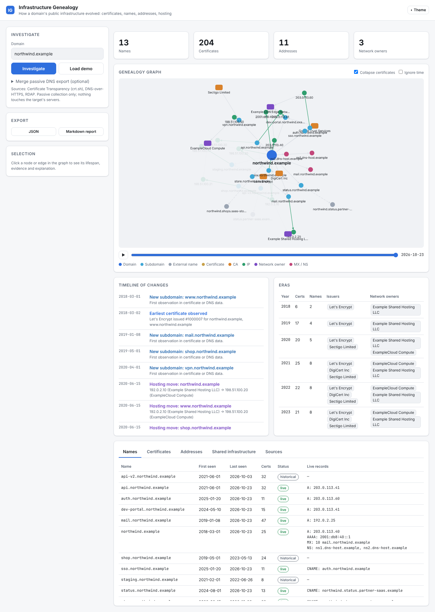

# Infrastructure Genealogy

**See how a domain's public infrastructure changed over time: certificates, subdomains, DNS, IP addresses and hosting providers, with evidence for every link.**



Enter a domain and the tool reconstructs its *genealogy*:

* a **time-aware graph** of the domain, its subdomains, certificates, certificate authorities, IP addresses, network owners, mail servers and nameservers. A time slider (with playback) shows the infrastructure as it existed on any given date
* a **timeline of changes**: new subdomains, certificate-authority migrations, hosting moves, IP changes, and names that were probably decommissioned
* **eras**: a year-by-year summary of which CAs and hosting networks were in use
* **shared-infrastructure observations** (co-hosted names, certificates covering foreign names), labelled as observations rather than attributions
* a **provenance trail**: every edge cites its source, retrieval time, SHA-256 of the raw response, and an Admiralty grade (A1–F6) converted to a confidence score

All collection is **passive**. The tool queries public aggregators (Certificate Transparency logs, DNS-over-HTTPS resolvers, RDAP) and never connects to the target's own servers.

---

## Quick start

```bash
git clone https://github.com/Sentinel1569/osint-infra-genealogy.git
cd osint-infra-genealogy
python -m venv .venv && source .venv/bin/activate     # Windows: .venv\Scripts\activate
pip install -e ".[dev]"

python -m infragen serve          # http://127.0.0.1:8000, then click "Load demo"
```

In **VS Code**, open the folder and accept the recommended extensions. The *Run and Debug* panel then offers *Web app (demo data)*, *Web app (live sources)* and *Tests*.

### Command line

```bash
python -m infragen demo                                    # offline synthetic dataset
python -m infragen investigate example.com                 # live: summary + change timeline
python -m infragen investigate example.com --markdown > report.md
python -m infragen investigate example.com --json --pdns samples/passive_dns_example.csv
```

## Data sources

| Source | What it contributes | Grade |
|---|---|---|
| [crt.sh](https://crt.sh) Certificate Transparency | Every publicly logged certificate: names, issuer, validity window. This is the backbone of the history. | A2 |
| DNS-over-HTTPS ([Google](https://dns.google), [Cloudflare](https://cloudflare-dns.com) fallback) | Current A / AAAA / CNAME / MX / NS records | A1 |
| [RDAP](https://rdap.org) | Who holds the address block each IP sits in | A2 |
| Passive DNS export (optional upload) | Historical resolutions, which is what makes hosting moves visible. Accepts CSV or [COF](https://datatracker.ietf.org/doc/draft-dulaunoy-dnsop-passive-dns-cof/) JSON lines from any provider you have access to. | B2 |

Responses are cached in `.cache/` (default TTL 1 h, set with `OSINT_CACHE_TTL`) so repeat runs don't hit public services again and an investigation can be replayed. Set `OSINT_OFFLINE=1` to forbid all network access.

## How it works

```
collectors ──► Investigation ──► graph (nodes + edges with first_seen/last_seen + evidence refs)
 (CT, DoH,        │               ├─ timeline  (derived change events)
  RDAP, pDNS)     │               ├─ eras      (per-year rollup)
                  │               └─ shared    (co-location observations)
                  └─ sources[]  (Evidence: url, retrieved_at, sha256, grade)
```

* `infragen/sources.py`: fetching and **pure parsers** for crt.sh, DoH, RDAP and passive DNS. Precertificate and leaf entries are de-duplicated, and wildcards are normalised.
* `infragen/genealogy.py`: the `Investigation` model. Each relationship merges repeated observations, widens its lifespan, keeps every evidence reference and records why it exists.
* `infragen/evidence.py`: Admiralty grading, noisy-OR confidence combination that discounts repeats from the same source, and SHA-256 helpers.
* `infragen/demo.py`: an offline dataset emitted in the services' **raw** response formats, so the demo runs through exactly the same parsers as live mode.
* `infragen/static/`: a framework-free UI built on a vendored Cytoscape.js, so it works offline.

### Interpretation rules

| Observation | What the tool records | What it does **not** conclude |
|---|---|---|
| Name appears in a certificate | The CA validated control of the name at issuance | That the name still resolves |
| Two names share an IP | `shared_ip` observation | Common ownership (CDNs and shared hosting are common) |
| RDAP lists organisation X for an IP | X holds the address block | That X operates the service |
| No live DNS and no recent certificate | "Last seen", possibly decommissioned | Deletion (it may sit behind a wildcard certificate) |

## API

| Method | Path | Body / query |
|---|---|---|
| `GET` | `/api/health` | |
| `GET` / `POST` | `/api/investigate` | `domain`, `demo`, `passive_dns` (POST only) |
| `GET` | `/api/report.md` | `domain`, `demo` |
| `POST` | `/api/report.md` | a previous investigation result, rendered without re-collecting |

Interactive docs are at `/docs`.

## Tests

```bash
make test        # or: OSINT_OFFLINE=1 pytest -q
make lint
```

CI runs ruff and pytest on Python 3.10, 3.12 and 3.13.

## Responsible use

Use this tool on domains you own or are authorised to assess, or for defensive research on public infrastructure. It only reads public, aggregate data, but those data sources have usage policies of their own: crt.sh in particular is a free community service, so keep queries modest. The demo uses the reserved `.example` TLD (RFC 2606) and documentation IP ranges (RFC 5737 / RFC 3849).

## License

MIT. Bundles Cytoscape.js (MIT); see `infragen/static/vendor/`.
